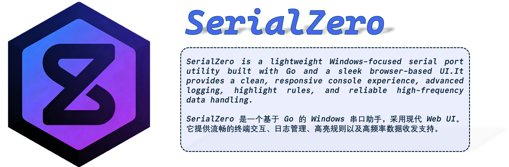
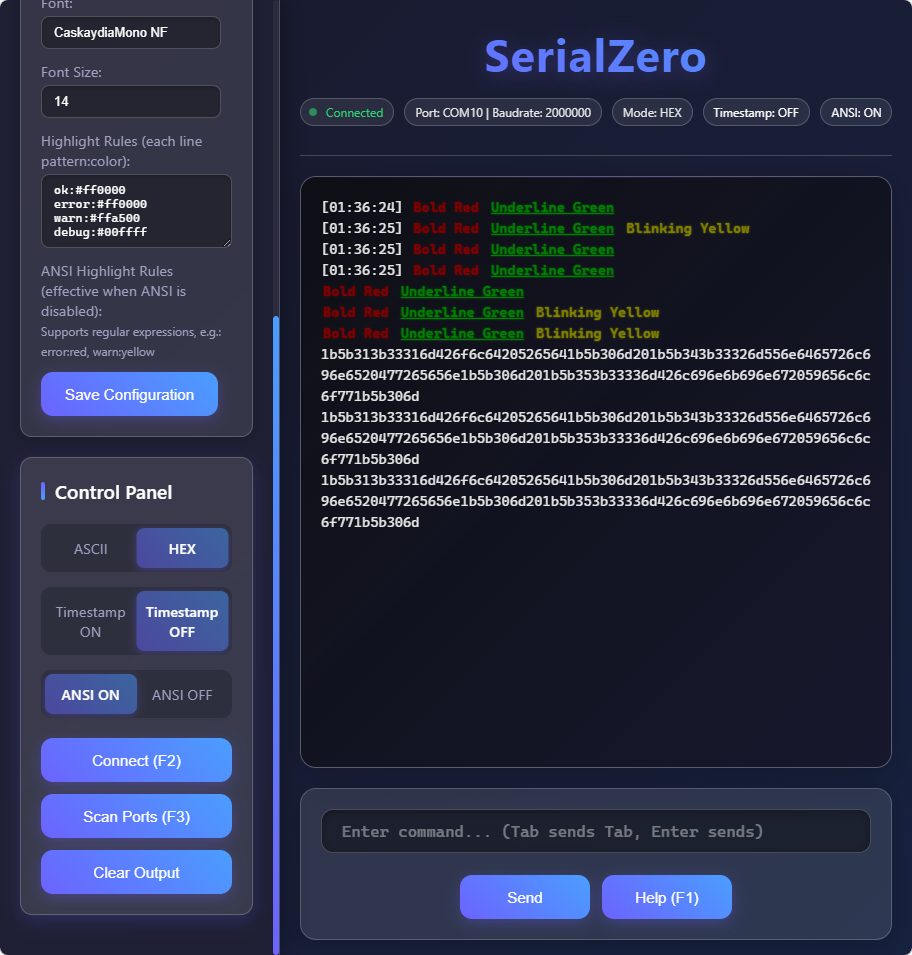
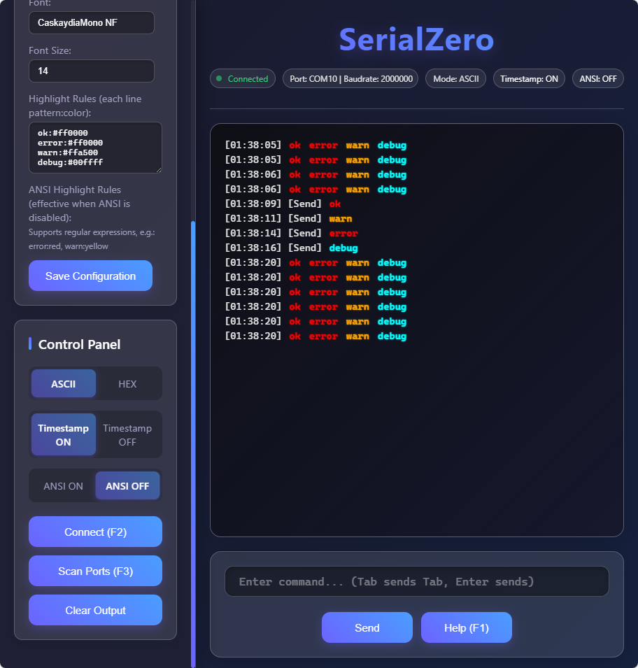

# SerialZero

**A professional serial terminal for Windows — native shell emulation, real-time visualization, zero clutter.**

[](https://github.com/Astor-Zore/SerialZero)

---

## Overview

SerialZero pairs a single-file Go backend with an embedded web frontend, delivered as one native Windows executable with no runtime dependencies. A frameless WebView2 window hosts a terminal built with xterm.js; serial data streams over WebSocket with sub-millisecond latency.

<p align="center">
  
</p>

| | |
|---|---|
| **Shell mode** | Full ANSI/VT terminal emulation — escape codes, colors, cursor control, exactly as a real terminal |
| **RAW mode** | Traditional serial view with virtualized rendering — hundreds of thousands of lines at 60 fps |
| **Quick commands** | One-click chips with `Ctrl+1..9` hotkeys; editable inline |
| **Command palette** | `Ctrl+K` — fuzzy search every action in the app |
| **Highlighting** | Per-session `regex:color` rules, applied in real time |
| **Session logs** | Automatic per-connection logging with timestamp gutters |
| **Undo** | Cleared the buffer by mistake? Undo restores it for 5 seconds |
| **Echo suppression** | Device loopback is filtered automatically |
| **Lua automation** | Scripted send/wait sequences in `./scripts/` |
| **Multi-instance** | Run several SerialZero windows on different ports |

## Screenshots

<p align="center">
  <a href="https://github.com/Astor-Zore/SerialZero/blob/master/pictures/ansi.png"></a>
  <a href="https://github.com/Astor-Zore/SerialZero/blob/master/pictures/highlight.png"></a>
</p>
<p align="center"><sub>Shell mode (left) · RAW mode with custom highlights (right)</sub></p>

## Quick Start

1. Run `SerialZero.exe` — a native window opens; no browser tab needed.
2. `F3` to scan ports, `F2` to connect.
3. Type in the terminal. That's it.

Or open `http://localhost:8080` from any browser on the same machine.

## Keybindings

| Action | Key |
|---|---|
| Connect / disconnect | `F2` |
| Scan ports | `F3` |
| Command palette | `Ctrl+K` |
| Quick command 1–9 | `Ctrl+1..9` |
| Toggle mode | click `SHELL`/`RAW` badge (bottom-left) |
| Send history | `↑` / `↓` |
| Close modal / palette | `Esc` |

## Configuration

`config.toml` is generated with defaults on first run; most settings are editable live from the sidebar and saved silently.

```toml
[serial]
port = "COM43"
baud = 115200
databits = 8
stopbits = 1
parity = "N"

[log]
path = "./logs"          # anchored to the exe directory

[ui]
font = "Cascadia Code"   # any monospace font detected on the system
fontsize = 14
timestamp = true
shell = true

[highlight]
groups = ["error:#ff0000", "warn:#ffa500", "ok:#00ff00"]
```

## Build

Requires Go 1.20+ and a Windows toolchain:

```bash
go mod tidy
go build -ldflags="-H windowsgui" -o SerialZero.exe
```

The frontend is embedded at compile time — the binary is the whole distribution.

## Architecture Notes

- `main.go` — backend: Win32 frameless window, WebView2 host, Gin server, serial I/O, Lua engine
- `static/` + `index.html` — embedded frontend (xterm.js, virtualized raw view)
- `scripts/` — Lua automation scripts (`send`, `delay`, `log`, `wait`)
- `winres/` — icon resources (`.syso` files are pre-built; regenerate only if the icon changes)

Serial port discovery reads the Windows registry (`HARDWARE\DEVICEMAP\SERIALCOMM`), so builds target Windows only.

## Contributing

By [Astor.Jiang](https://github.com/Astor-Zore) — issues and PRs welcome.

## License

MIT
